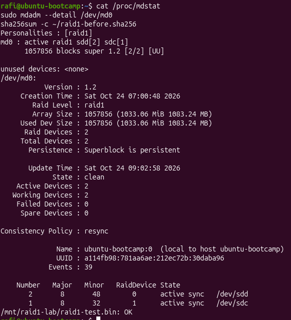
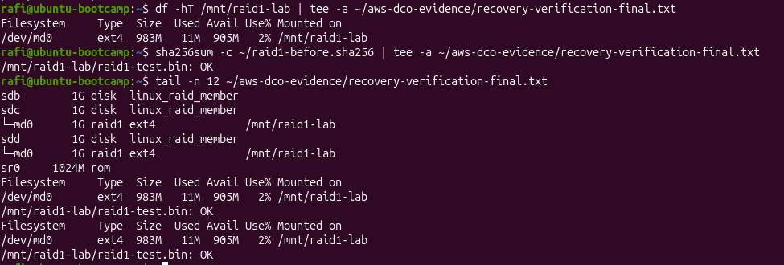

# Evidence Inventory — RAID1 Failure & Recovery

This directory separates **original terminal screenshots** from **transcribed observations**. Images are from the Ubuntu VM exercise on 24 October 2026; all failure and recovery operations were performed against virtual disks.

## Original screenshots available in this repository

| Screenshot | Direct link | What it demonstrates |
|---|---|---|
| Recovered RAID1 and SHA-256 check | [03-recovered-raid1.png](03-recovered-raid1.png) | Two active array members, clean state, zero failed devices, sample-file checksum `OK` |
| ext4 filesystem and SHA-256 check | [04-filesystem-sha256-verification.png](04-filesystem-sha256-verification.png) | `/dev/md0` mounted at `/mnt/raid1-lab` as ext4; checksum `OK` |

### Recovery screenshot

### Filesystem screenshot

## Other evidence available

| Evidence | Source | Status |
|---|---|---|
| Initial healthy RAID1 `[UU]` | [Earlier terminal excerpts](observed-terminal-excerpts.md) | Documented transcript; original image not uploaded |
| Initial 10 MiB test and checksum | [Earlier terminal excerpts](observed-terminal-excerpts.md) | Documented transcript and known baseline hash |
| Degraded RAID1 `[_U]` | [Earlier terminal excerpts](observed-terminal-excerpts.md) | Documented transcript; original image not uploaded |
| Final RAID health + disk layout + mounted filesystem + checksum | [Final captured output](../logs/recovery-verification-final.txt) | File contains text copied from actual Ubuntu terminal output into chat, then committed to GitHub |
| SHA-256 specifically during degraded state | No preserved result | **Not independently verified** |

## Integrity and provenance notes

- The two PNGs above are original screenshots supplied by the lab participant and uploaded to GitHub, not generated illustrations.
- [Earlier terminal excerpts](observed-terminal-excerpts.md) are **transcriptions from conversation evidence**, not raw files collected via terminal logging.
- The final text log was copied from terminal output into the conversation and uploaded without deliberately removing repeated lines. It is **not a verified byte-for-byte transfer** of the file residing in the VM, and it does not contain the full execution history.
- The log includes a repeated filesystem-and-checksum block because the output was appended twice during evidence collection.
- The host, local username and RAID identifiers visible in screenshots are lab information. No passwords or access tokens were visible in the inspected evidence.

Additional screenshots of the pre-failure or degraded stage should be uploaded **only if the originals are recovered**. No replacement evidence should be fabricated.
